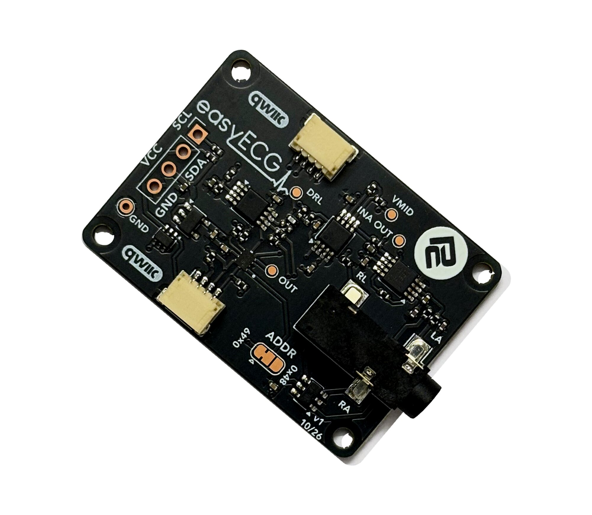

# Protocentral easyECG Breakout — Hardware

Open-source hardware design files for the **Protocentral easyECG Breakout**, a single-lead ECG board on I²C / Qwiic. Instead of one integrated front-end chip, it uses parts you can probe: a [TI INA333](https://www.ti.com/product/INA333) instrumentation amplifier, two [TI OPA2333](https://www.ti.com/product/OPA2333) op-amps and a [TI TLA2024](https://www.ti.com/product/TLA2024) 12-bit ADC.

## Don't have one? [Buy it here](https://protocentral.com/product/easyecg-single-lead-ecg-breakout-qwiic/)

## Links

| | |
|---|---|
| Product page | https://protocentral.com/product/easyecg-single-lead-ecg-breakout-qwiic/ |
| Getting Started guide | https://protocentral.com/product/easyecg-single-lead-ecg-breakout-qwiic/docs/getting-started/ |
| Arduino library | https://github.com/Protocentral/protocentral_easyecg_arduino |
| MicroPython / Raspberry Pi library | https://github.com/Protocentral/protocentral-micropython-easyecg |

## Specifications

- **Lead:** single lead (Lead I), 3 electrodes
- **Front end:** TI INA333 instrumentation amplifier, two TI OPA2333 op-amps, TI TLA2024 12-bit ADC
- **Gain:** ×535
- **Bandwidth:** 0.5–31 Hz
- **Resolution:** about 1.87 µV per count at the electrodes
- **Input range:** about ±3.1 mV
- **Interface:** I²C / Qwiic, address 0x49 (0x48 via the ADDR jumper)
- **Connectors:** 2 × Qwiic / STEMMA QT, 3.5 mm electrode jack, 0.1" header
- **Supply:** 3.3 V on Qwiic; 3.3–5 V on the header
- **Board:** 40.0 × 28.8 mm

## Electrode connections

| Jack contact | Signal | Lead colour | Placement (chest) |
|---|---|---|---|
| Sleeve | **LA** | Green | below the left collarbone |
| Ring | **RA** | Red | below the right collarbone |
| Tip | **RL** (right-leg drive) | Yellow | lower right abdomen, or over the hip bone |

Lead colours are for the 3-lead cable supplied in the kit. The recorded lead is Lead I (LA − RA).

## Repository layout

| Folder | Contents |
|---|---|
| [`hardware/`](hardware/) | KiCad project (schematic + PCB layout) and the exported [schematic PDF](hardware/protocentral-easyecg-schematic.pdf) |

## Revisions

| Revision | Date | Notes |
|---|---|---|
| v1 | 2026-10 | First release |

## Important notice

easyECG is for research, education and evaluation only. It is **not a medical device** and has no FDA, CE or FCC approval. It has **no patient isolation**: with electrodes on a person, use a battery-powered host or an [easyISO isolated Qwiic adapter](https://protocentral.com/product/easyiso-isolated-qwiic-adapter/), and a battery-powered scope on the test points. A mains-earthed bench scope connects the person wearing the electrodes to earth. This board's silkscreen doesn't carry that warning.

## License

The hardware design files in this repository are licensed under the **CERN Open Hardware Licence Version 2 – Permissive (CERN-OHL-P v2)**. See [LICENSE](LICENSE).

The accompanying libraries (in the separate [protocentral_easyecg_arduino](https://github.com/Protocentral/protocentral_easyecg_arduino) and [protocentral-micropython-easyecg](https://github.com/Protocentral/protocentral-micropython-easyecg) repositories) are licensed under the MIT License.
